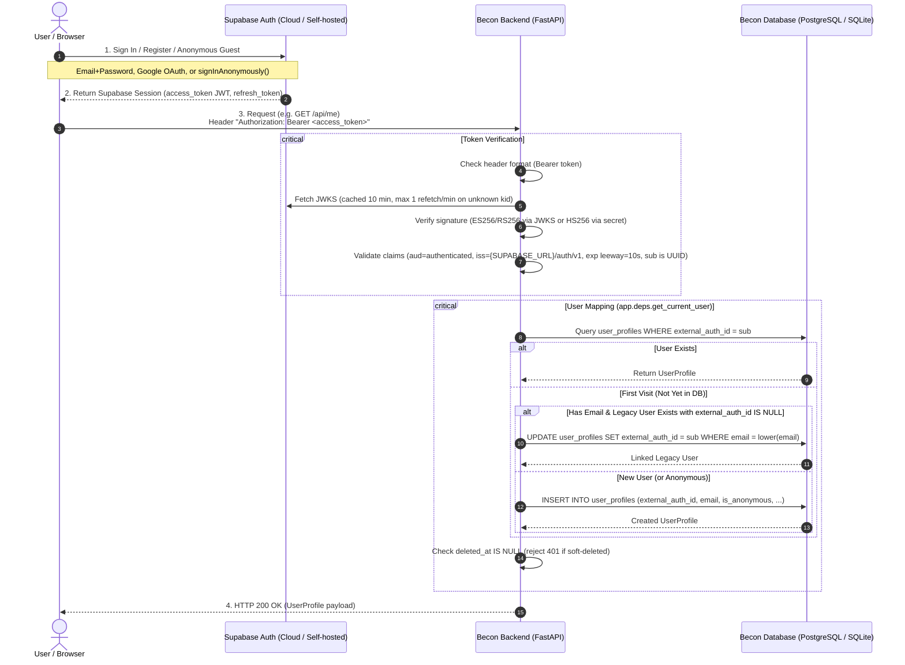
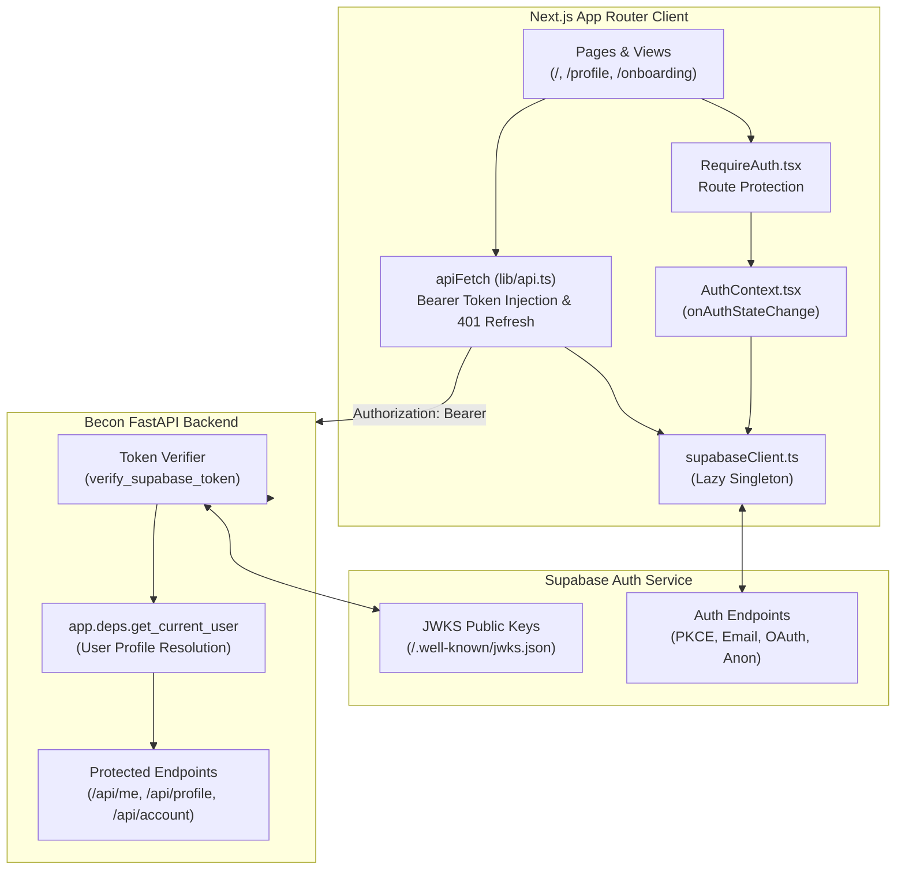

# Becon Authentication & Identity Architecture

This document specifies the authentication and authorization model for Becon.

In accordance with **Decision D3**, **Supabase Auth is the single identity system** across both development and production. The custom local JWT issuance and verification system (`app/auth.py`, `/api/register`, `/api/login`, `/api/auth/guest`, `/api/auth/supabase-sync`) has been retired.

---

## 1. Authentication Flow & Sequence Diagram

The browser client authenticates directly with Supabase Auth (via email/password, Google OAuth, or anonymous guest sign-in). The client sends the returned Supabase Access Token (a signed JWT) in the standard HTTP `Authorization: Bearer <token>` header to the Becon FastAPI backend.

The backend verifies the token and maps it to a local row in the `user_profiles` database table using the Supabase user UUID (`external_auth_id`).

---

## 2. Environment Variables & Secret Storage

| Variable | Scope | Where Configured | Secret? | Purpose |
| :--- | :--- | :--- | :--- | :--- |
| `NEXT_PUBLIC_SUPABASE_URL` | Frontend | `frontend/.env.local` | No (Public) | Supabase project endpoint for auth SDK |
| `NEXT_PUBLIC_SUPABASE_ANON_KEY` | Frontend | `frontend/.env.local` | No (Public) | Browser publishable API key |
| `SUPABASE_URL` | Backend | `backend/.env` | No (Internal) | Supabase project endpoint for JWKS & Admin API |
| `SUPABASE_JWT_AUDIENCE` | Backend | `backend/.env` | No | Expected JWT audience (defaults to `authenticated`) |
| `SUPABASE_JWT_SECRET` | Backend | `backend/.env` | **Yes (Secret)** | Optional fallback secret for legacy HS256 verification |
| `SUPABASE_SERVICE_ROLE_KEY` | Backend | `backend/.env` | **Yes (Secret)** | Required for `DELETE /api/account` (Admin API) |

> [!IMPORTANT]
> - **Never** expose `SUPABASE_SERVICE_ROLE_KEY` or `SUPABASE_JWT_SECRET` to the frontend or git.
> - In `production`, `SUPABASE_URL` is mandatory on the backend; the backend fails fast at startup if it is missing.
> - In `development`, if `SUPABASE_URL` is unset, protected backend endpoints return `503 Service Unavailable` with a clear actionable error message.

---

## 3. Supabase Dashboard Configuration Checklist

To configure your Supabase project for Becon:

1. **Authentication $\rightarrow$ Providers $\rightarrow$ Email**:
   - [x] Enable Email provider.
   - [x] **Confirm email**: Enable (requires users to verify their email before first sign-in).
   - [x] Secure email change: Enable.
2. **Authentication $\rightarrow$ Providers $\rightarrow$ Anonymous Sign-Ins**:
   - [x] **Enable Anonymous Sign-Ins**: Turned ON (enables instantaneous zero-friction guest mode for new users without passwords).
3. **Authentication $\rightarrow$ URL Configuration**:
   - [x] **Site URL**: `http://localhost:3000` (development) or production domain.
   - [x] **Redirect URLs**:
     - `http://localhost:3000/auth/callback`
     - `http://localhost:3000/auth/reset-password`
     - Production equivalents when deployed.
4. **Authentication $\rightarrow$ Providers $\rightarrow$ Google (Optional)**:
   - Configure Google Client ID and Client Secret in the Supabase Dashboard (not on the Becon backend).
   - Add authorized redirect URI in Google Cloud Console: `https://<supabase-project-id>.supabase.co/auth/v1/callback`.
5. **API Settings $\rightarrow$ JWT Verification**:
   - Verify whether your project signs tokens with **Asymmetric Keys (ES256 or RS256)** or **Symmetric Secret (HS256)**.
   - If using asymmetric keys (standard for modern Supabase projects), leave `SUPABASE_JWT_SECRET` unset; the backend verifies tokens via JWKS automatically.
   - If using legacy HS256, set `SUPABASE_JWT_SECRET` from **Settings $\rightarrow$ API $\rightarrow$ JWT Secret**.

---

## 4. User Account Linking & Deletion Architecture

### User Mapping Rules (`app.deps.map_token_to_user`)
1. **Direct Match:** Search `user_profiles` where `external_auth_id == sub`. If found, return user.
2. **Legacy User Migration:** If not found and token contains an `email`:
   - Search `user_profiles` by lowercase email.
   - If found with `external_auth_id IS NULL`, link it to this `sub`.
   - If found with a *different* `external_auth_id`, reject with `409 Conflict` (prevent account takeover).
3. **New User Creation:**
   - Anonymous users: `is_anonymous=True`, `email=None`.
   - Authenticated users: `is_anonymous=False`, `email=lowercase(email)`, name from `user_metadata.full_name`.
4. **Concurrency Handling:** If a race occurs on first login, catch `IntegrityError`, rollback session, and re-query by `external_auth_id`.
5. **Soft-Delete Guard:** If `deleted_at` is set, reject with `401 Unauthorized` ("Account has been deleted").

### Account Deletion (`DELETE /api/account`)
Per GDPR/privacy rights and technical hygiene:
1. Client issues `DELETE /api/account` with Supabase Bearer token.
2. Backend calls Supabase Admin API:
   `DELETE {SUPABASE_URL}/auth/v1/admin/users/{sub}` with `apikey: {SUPABASE_SERVICE_ROLE_KEY}`.
3. If Supabase returns an error (4xx/5xx), backend halts and returns `502 Bad Gateway`, leaving the local user record intact.
4. If Supabase successfully deletes the user:
   - Backend deletes the local `user_profiles` row.
   - Database foreign key constraints cascade deletion to `saved_cards`, `user_follows`, `card_feedback`, `deliveries`, and `metrics_events`.
   - Backend returns `204 No Content`.

---

## 5. Row Level Security (RLS) on PostgreSQL

The Supabase project exposes a PostgREST Data API on `/rest/v1`. Because the Supabase anon key is public in the browser:
- Migration `0003_supabase_auth_rls` executes `ALTER TABLE <table_name> ENABLE ROW LEVEL SECURITY;` on all 21 tables in PostgreSQL.
- With zero policies defined, **all direct queries via PostgREST using the anon or authenticated roles are denied by default**.
- The Becon backend connects directly using the PostgreSQL connection string (`DATABASE_URL`) as the database owner, which **bypasses RLS by default**.
- This guarantees that client applications cannot bypass FastAPI business logic or read/write arbitrary tables directly via Supabase.

---

## 6. Frontend Authentication Architecture (Phase 1.4b)

The frontend client application uses a layered auth architecture:

### Core Components
1. **Lazy Supabase Client (`lib/supabaseClient.ts`)**: Initializes `@supabase/supabase-js` with `persistSession: true`, `autoRefreshToken: true`, and `detectSessionInUrl: true`. Fails gracefully during build time if environment variables are missing.
2. **`AuthContext` (`context/AuthContext.tsx`)**: Global provider that listens to `onAuthStateChange` events (`SIGNED_IN`, `SIGNED_OUT`, `TOKEN_REFRESHED`, `USER_UPDATED`). Exposes session state, anonymous flag, user metadata, and methods (`signInWithPassword`, `signUpWithPassword`, `signInWithGoogle`, `signInAsGuest`, `signOut`, `sendPasswordReset`, `updatePassword`, `upgradeGuestWithEmail`). Synchronizes cache with `syncUserCache(userId)`.
3. **`apiFetch` (`lib/api.ts`)**: Central fetch wrapper that resolves the latest Supabase access token, attaches `Authorization: Bearer <token>`, handles 401 with a single session refresh retry, and triggers local sign-out and redirect to `/login` if authentication cannot be renewed.
4. **`RequireAuth` (`components/RequireAuth.tsx`)**: Higher-order route wrapper and `useRequireAuth` hook that redirects unauthenticated users to `/login?next=<encodedPath>` while rendering a calm loader during credential checks.
5. **Cache Hygiene (`lib/cache.ts`)**: Ensures all user preferences and briefings caches (`becon_cached_briefings_*`, `becon_user_name`, `becon_user_avatar`) are purged upon sign-out, account deletion, or account switching, while strictly preserving `becon_theme`.

---

## 7. Manual QA Checklist for Project Lead

Run this checklist against a live Supabase project to verify end-to-end functionality:

- [ ] **1. Email/password sign-up**:
  - Navigate to `/register`.
  - Enter valid email and password (>= 8 chars).
  - Submit: Verify calm confirmation message appears ("Check your email").
  - Click confirmation link in email: Redirects to `/profile?setup=true` (or `/auth/callback`).
- [ ] **2. Email/password sign-in**:
  - Navigate to `/login`.
  - Sign in with verified credentials: Redirects to `/` (or destination specified in `?next=`).
- [ ] **3. Google OAuth sign-in**:
  - Click "Continue with Google" on `/login` or `/register`.
  - Complete Google consent: Redirects through `/auth/callback` to `/profile?setup=true` (first time) or `/`.
- [ ] **4. Anonymous Guest exploration**:
  - On `/login`, click "Continue as Guest".
  - Redirected to `/`: Verify `<GuestBanner />` displays with upgrade prompt.
- [ ] **5. Guest account upgrade**:
  - Click upgrade button on `<GuestBanner />` or navigate to `/register?mode=upgrade`.
  - Enter email and password: Confirm session upgrades to permanent account without losing reading history.
- [ ] **6. Password reset**:
  - Navigate to `/forgot-password`, enter registered email, and submit.
  - Open email link: Redirected to `/auth/reset-password`.
  - Enter new password (>= 8 chars) and save: Verify successful login with new password.
- [ ] **7. Danger zone account deletion**:
  - Navigate to `/profile`, scroll to "Danger Zone".
  - Type `DELETE` into the confirmation field and click "Permanently Delete Account".
  - Verify `DELETE /api/account` returns 204, Supabase user and local database rows are purged, and user is redirected to `/login?deleted=1`.
- [ ] **8. Silent token refresh**:
  - Wait until the Supabase access token expires (or manually test with an expired token).
  - Verify `apiFetch` calls `refreshSession()` and transparently completes the API request without user interruption.
- [ ] **9. Theme preservation on sign-out**:
  - Switch theme to Dark Mode via top theme toggle.
  - Sign out: Verify `/login` remains in Dark Mode (`becon_theme` preserved, all other caches cleared).

---

## 8. Known Limitations & Follow-Up Tasks

- **Task 6.7 (Anonymous User Cleanup):** Anonymous guest accounts accumulate over time. A periodic cleanup job will purge anonymous users older than 30 days that have no saved cards or follows, and support converting anonymous sessions to permanent email accounts.
- **Task 7.1 (Custom SMTP):** Default Supabase email service is rate-limited to 30 emails per hour. Production deployment will configure Resend SMTP in the Supabase Dashboard.
- **Task 8.1 (CAPTCHA for Anonymous Sign-Ins):** To prevent bot spam on anonymous user creation in production, Cloudflare Turnstile CAPTCHA will be enabled in Supabase Auth settings.
