# Becon Data Model & Schema Architecture

## 1. Overview & Pipeline Architecture

Becon is a career update companion that delivers a 3–5 minute daily briefing of source-grounded **Action Cards** (What happened, Why it matters, How it affects you, What to do next).

The data model is profession-agnostic: professions, focus topics, and sources are data rows in tables rather than hardcoded enums or static types.

### Content Pipeline Flow

```
[Sources (Feeds, Releases, Advisories)]
                 │
                 ▼ (Fetch)
           [Raw Items] (URLs, content hashes, external IDs)
                 │
                 ▼ (Normalize & Deduplicate)
              [Events] (Canonical career occurrences, severity 0-100)
                 │
                 ▼ (AI Synthesis & Fact-check)
              [Cards] (1 shared card per event, grounded in source text)
                 │
                 ▼ (Personalization)
          [Card Variants] (Per-profession / per-topic tailored implications)
                 │
                 ▼ (User Delivery & Ranking)
    [User Deliveries / Feed / Bookmarks]
```

---

## 2. Entity-Relationship Diagram

```mermaid
erDiagram
    professions ||--o{ profession_topics : "suggests"
    focus_topics ||--o{ profession_topics : "included_in"
    focus_topics ||--o{ topic_aliases : "has"
    focus_topics ||--o{ focus_topics : "parent_of"
    
    user_profiles ||--o{ user_focus_topics : "tracks"
    focus_topics ||--o{ user_focus_topics : "tracked_by"
    
    professions ||--o{ user_profiles : "categorizes"
    
    sources ||--o{ source_topics : "covers"
    focus_topics ||--o{ source_topics : "covered_by"
    
    sources ||--o{ source_professions : "serves"
    professions ||--o{ source_professions : "served_by"
    
    user_profiles ||--o{ user_follows : "follows"
    sources ||--o{ user_follows : "followed_by"
    
    sources ||--o{ raw_items : "produces"
    events ||--o{ raw_items : "groups"
    
    events ||--o{ event_topics : "tagged_with"
    focus_topics ||--o{ event_topics : "associated_with"
    
    events ||--|| cards : "synthesized_into"
    
    cards ||--o{ card_variants : "has_variants"
    professions ||--o{ card_variants : "tailors_for"
    focus_topics ||--o{ card_variants : "tailors_for_topic"
    
    user_profiles ||--o{ saved_cards : "bookmarks"
    cards ||--o{ saved_cards : "bookmarked_in"
    
    user_profiles ||--o{ card_feedback : "rates"
    cards ||--o{ card_feedback : "rated_by"
    
    user_profiles ||--o{ error_reports : "submits"
    cards ||--o{ error_reports : "reported_on"
    
    user_profiles ||--o{ deliveries : "receives"
    user_profiles ||--o{ metrics_events : "generates"
```



---

## 3. Table Catalog & Purposes

### `professions`
Represents professional domains (e.g., Software Development, Accounting and Finance). Serves as the root grouping for onboarding topic suggestions and card variant personalization.

### `focus_topics`
Canonical tools, technologies, platforms, languages, regulations, and standards that users follow (e.g., Next.js, Docker, IFRS). Supports hierarchical parent-child relationships (e.g., `.NET` $\rightarrow$ `C#`).

### `topic_aliases`
Stores alternative names, abbreviations, and common misspellings (lowercase) mapping to a canonical focus topic (e.g., `next`, `nextjs`, and `next.js` resolve to `Next.js`).

### `profession_topics`
Many-to-many relationship linking professions to suggested focus topics displayed during user onboarding and topic exploration.

### `user_focus_topics`
Explicit topic preferences selected by users with optional version constraints (e.g., Python 3.12, Next.js 15) to drive personal briefing ranking.

### `sources`
Authoritative external feeds (RSS, Atom, GitHub releases, security advisories). Tracks fetch intervals, ETag/Last-Modified HTTP caching headers, health state (`last_fetched_at`, `last_success_at`, `consecutive_failures`, `last_error`, `status`), scheduling (`next_fetch_at`), distributed lease locking (`lease_expires_at`, `fetch_started_at`), and trust tiers.

### `source_topics`
Mapping of external content sources to the focus topics they reliably cover.

### `source_professions`
Many-to-many relationship linking external content sources to the target professions they serve.

### `user_follows`
Prepares creator and specific source following functionality (Phase 9), enabling users to subscribe to trusted individual publishers.

### `raw_items`
Unprocessed items retrieved by background ingesters from external sources. Enforces unique URL hashes per source and records raw content, processing status, linked event, and `raw_metadata` JSON for structured advisory data (CVE IDs, CVSS scores, severity, affected packages, and extraction status).

### `events`
Canonical, deduplicated career occurrences distilled from one or more raw items. Captures event category, breaking change flags, and severity scores ($0$–$100$).

### `event_topics`
Connects events to relevant focus topics along with version metadata and topic-matching confidence scores ($0.0$–$1.0$).

### `cards`
The core briefing artifact: exactly one shared canonical Action Card per event. Grounded exclusively in source text with strict structure (`what_happened` JSON list, `why_it_matters`, `how_it_affects_you`, and `action_guidance`).

### `card_variants`
Role- and topic-specific adaptations of the personalized sections (`how_it_affects_you` and `action_guidance`) tailored to specific professions or sub-specializations.

### `saved_cards`
User bookmarks for archiving important Action Cards for long-term reference.

### `card_feedback`
User quality feedback (+1 helpful / -1 not helpful) used to calibrate ranking and AI prompt quality.

### `error_reports`
User reports flagging factual inaccuracies or hallucinations in Action Cards for review and prompt iteration.

### `deliveries`
Schedules and logs outbound notifications and digest briefings via email or Telegram.

### `metrics_events`
Product telemetry and interaction logs. **Rule**: Strict privacy boundary — absolutely no personal data (emails, passwords, tokens) allowed in properties JSON.

### `user_profiles` (Existing Table, Migrated)
Stores user identity, authentication provider, delivery preferences, timezone, and profession link.

### `daily_briefings`
Stores personalized daily intelligence briefing card payloads cached per user per UTC day, with calculated estimated reading times.

### `saved_briefings` (Legacy Table, Retained)
Retained for backwards compatibility; marked `DEPRECATED`. No longer created by modern pipeline and will be dropped in Phase 6.5 (after `saved_cards` UI ships).

---

## 4. Vocabularies & Constraints

All vocabularies are stored as short strings governed by database `CHECK` constraints (rather than DB enum types) to ensure portable cross-database support and frictionless schema evolution:

| Vocabulary | Table & Column | Permitted Values |
| :--- | :--- | :--- |
| **Topic Kind** | `focus_topics.kind` | `'technology'`, `'tool'`, `'language'`, `'platform'`, `'domain'`, `'regulation'`, `'standard'`, `'topic'` |
| **Source Type** | `sources.type` | `'rss'`, `'atom'`, `'github_release'`, `'advisory'`, `'youtube_channel'`, `'x_account'`, `'instagram_account'` |
| **Trust Tier** | `sources.trust_tier` | `1` (Official), `2` (Reputable), `3` (Community) |
| **Raw Item Status** | `raw_items.status` | `'new'`, `'processed'`, `'skipped'`, `'error'` |
| **Event Category** | `events.category` | `'release'`, `'deprecation'`, `'security'`, `'eol'`, `'industry'`, `'content'` |
| **Event Status** | `events.status` | `'open'`, `'ready'`, `'published'`, `'flagged'` |
| **Severity Score** | `events.severity_score` | Integer $0$ to $100$ |
| **Action Type** | `cards.action_type`, `card_variants.action_type` | `'learn'`, `'apply'`, `'avoid'`, `'prepare'` |
| **Card Status** | `cards.status` | `'draft'`, `'published'`, `'retracted'` |
| **Validation Status** | `cards.validation_status` | `'pending'`, `'passed'`, `'failed'`, `'flagged'`, `'unvalidated'` |
| **Feedback Value** | `card_feedback.value` | `-1`, `1` |
| **Error Report Status**| `error_reports.status` | `'open'`, `'reviewing'`, `'resolved'`, `'rejected'` |
| **Delivery Channel** | `deliveries.channel` | `'email'`, `'telegram'` |
| **Delivery Kind** | `deliveries.kind` | `'digest'`, `'alert'` |
| **Delivery Status** | `deliveries.status` | `'pending'`, `'sent'`, `'failed'`, `'skipped'` |

---

## 5. Notes on Legacy Fields & Deprecations

In `user_profiles`:
- `role`: **DEPRECATED**. Replaced by `profession_id` foreign key.
- `interests`: **DEPRECATED**. Replaced by normalized `user_focus_topics` table.
- `experience`: **DEPRECATED**.
- `customPrompt`: **DEPRECATED**.
- `aiTone`: **DEPRECATED**.

Legacy table `saved_briefings`:
- **DEPRECATED**. Does not link to users or support four-part Action Cards. Retained during Phase 1 transitions and targeted for deletion in Phase 6.5 (after `saved_cards` UI ships).

---

## 6. Migration & Database Workflow

Alembic manages all schema lifecycle events across SQLite (local development) and PostgreSQL / Supabase (production).

### Migration History
1. `0001_baseline`: Stamped baseline representing initial schema.
2. `0002_full_schema`: Full schema expansion (all application tables cataloged in Section 3), email deduplication, and check constraints.
3. `0003_supabase_auth_rls`:
   - Makes `user_profiles.email` nullable (`VARCHAR(255) NULL`).
   - Cleanses existing empty strings (`''`) and synthetic guest emails (`@guest.becon.local`) to `NULL`.
   - Enables Row Level Security (RLS) on all application tables and `alembic_version` in PostgreSQL with zero policies (blocking direct PostgREST Data API queries via anon/authenticated roles, while allowing backend service role/owner connections).
4. `0004_source_registry`:
   - Creates `source_professions` join table linking content sources to target professions.
   - Enables Row Level Security (RLS) on `source_professions` in PostgreSQL.
5. `0005_raw_items_raw_metadata`:
   - Adds `raw_metadata` (`PortableJSON`) column to `raw_items` for storing upstream payload attributes (CVSS scores, CISA KEV flags, modified timestamps).
6. `0006_source_health_and_scheduling`:
   - Adds source health tracking and distributed leasing columns to `sources`: `status`, `next_fetch_at`, `lease_expires_at`, `fetch_started_at`.
7. `0007_cards_validation_status_unvalidated`:
   - Expands `ck_cards_validation_status` check constraint to include `'unvalidated'` (designating heuristic fallback cards prior to Gemini validation).
8. `0008_daily_briefings_and_primary_tag`:
   - Adds `is_primary` (`BOOLEAN DEFAULT FALSE`) to `event_topics` to denote primary canonical tags.
   - Creates `daily_briefings` table for caching personalized intelligence briefings per user per UTC day (`user_id`, `briefing_date`, `cards_payload`, `reading_time_minutes`).
   - Enables Row Level Security (RLS) on `daily_briefings` in PostgreSQL.
9. `0009_profession_default`:
   - Adds `is_default` (`BOOLEAN DEFAULT FALSE`) to `professions` table to designate the DB-driven cold start fallback profession.
   - Updates seed data and database so `software-development` is default (`is_default = TRUE`).

### Adoption of Existing Local Database (`becon.db`)
Existing local databases containing the initial unversioned schema must be stamped with baseline `0001` before upgrading:
```powershell
# In repository root:
cd backend
..\backend\.venv\Scripts\alembic.exe stamp 0001
..\backend\.venv\Scripts\alembic.exe upgrade head
```
During `0002` upgrade, existing duplicate user emails are merged (keeping lowest user ID), emails are normalized to lowercase, and new columns are populated.

### Fresh Database Setup
For a fresh SQLite or PostgreSQL database:
```powershell
cd backend
..\backend\.venv\Scripts\alembic.exe upgrade head
```
Or use the helper script:
```powershell
.\scripts\dev.ps1 migrate
```

### Rolling Back Migrations
```powershell
cd backend
..\backend\.venv\Scripts\alembic.exe downgrade -1    # roll back one revision
..\backend\.venv\Scripts\alembic.exe downgrade base  # roll back all revisions
```

### Creating New Migrations
```powershell
.\scripts\dev.ps1 makemigration -Message "description_of_change"
```

---

## 7. Seed Data Management

Professions, focus topics, and authoritative content sources are maintained in version-controlled JSON data files:
- `backend/app/seed/data/professions.json`
- `backend/app/seed/data/topics.json`
- `backend/app/seed/data/sources.json`

To add a new profession or topic, update the JSON files directly. To apply seed changes idempotently:
```powershell
.\scripts\dev.ps1 seed
# or
cd backend
..\backend\.venv\Scripts\python.exe -m app.seed
```
The seeder performs upserts keyed by `slug`, synchronizes aliases, establishes parent-child hierarchies, and maps profession-topic relationships without creating duplicates.

---

## 8. Ingestion Pipeline & Persistence

The ingestion pipeline ([`backend/app/ingestion.py`](../backend/app/ingestion.py)) replaces transient in-memory card dictionaries with durable database persistence across `sources`, `raw_items`, `events`, `cards`, and `card_variants`:

1. **Source Tracking:** Resolves each configured feed URL into a `sources` record with fetch timestamps (`last_fetched_at`, `last_success_at`), error tracking (`last_error`), and consecutive failure counters.
2. **Idempotent Raw Ingestion:** Parses incoming feed items into `raw_items` with SHA-256 hashes on normalized canonical URLs and article content. Re-running ingestion on existing feeds generates zero duplicate raw items.
3. **Exact Deduplication into Events:** Merges duplicate items across feeds into a single canonical `events` entity via exact URL matching followed by case-insensitive title normalization.
4. **Single Shared Canonical Card:** Creates exactly one shared `cards` record per event storing structured 4-part intelligence (`what_happened`, `why_it_matters`, generic `how_it_affects_you`, and `action_guidance`).
5. **Lazy Variant Caching:** Role-specific adaptations (`how_it_affects_you` and `action_guidance`) are dynamically cached in `card_variants` keyed by `(card_id, profession_id)`. Subsequent requests for the same role hit the cache directly without additional AI inference or heuristic calls.
6. **Stale-While-Revalidate Serving:** `GET /api/briefings` queries persisted cards directly from the database (supporting pagination and scope slicing). When the newest card exceeds `FEED_CACHE_TTL_SECONDS` (1800s), an asynchronous background re-ingestion task is scheduled while the current feed is returned immediately.
